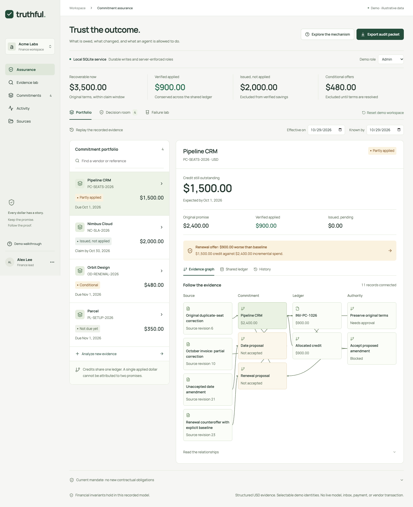

# Truthful · Team OVO

**A credit can be real. The deal can still be wrong.**

Truthful follows vendor commitments through evidence, amendments, approval, invoice application, and reversal. It asks three separate questions: **what is owed, what is the net value of this decision, and is this exact action still authorized?** Built for the BBS × Ramp technical round.

[Live browser demo](https://srujyama.github.io/truthful-ovo/) · [Narrated v3 demo](https://github.com/Srujyama/truthful-ovo/releases/tag/v3.0.0) · [Technical deep dive](docs/TECHNICAL_DEEP_DIVE.md) · [Submission status](docs/DELIVERY.md)



## Run the full build

Node 24 or later:

```sh
npm ci
npm run dev
```

Open **http://127.0.0.1:5173**. One supervisor starts Vite and the loopback HTTP/SQLite service. The banner confirms **Local SQLite service**. No API key or external account is required. SQLite data stays in the ignored `server/data/` directory.

The public GitHub Pages app runs the same financial engine in a clearly labeled **Browser workspace**, with localStorage persistence and selectable demonstration roles. It has no shared backend or independently enforced server authority. `npm run dev:web` runs just the browser UI.

## Five decisions worth demonstrating

1. **A concession can lose money.** Pipeline owes $1,500. Its renewal offer adds $2,400 of annual cost versus an explicit $6,000/month baseline. Net incremental value is **−$900**. Edit the comparison assumptions and see the calculation change without authorizing a deal.
2. **Proposals do not replace agreements.** A date amendment conflicts with the renewal. Dismiss an alternative with a retained reason, review the remaining branch, then approve and record it. Future acceptance affects terms only on its effective date.
3. **Approval expires when its basis changes.** Approve the original-terms action, revise a cited source, and try to execute. The previous approval is stale. Policy and ledger changes also invalidate it. Each approved local action executes once.
4. **An applied dollar belongs to one balance.** Credit capacity is conserved across the portfolio. Issued memos add no verified savings. A reversal reduces verified value and reopens the original obligation. Ambiguous matches are quarantined.
5. **Knowing later is different from being effective earlier.** Change **Effective on** and **Known by** independently. Replay the evidence available at the cutoff; later facts do not leak into the old history. Historical comparisons are read-only.

**Failure lab → Run all cases** executes nine adversarial scenarios with actual reducer commands, typed rejections, and thirty-one checks. Inspect the execution steps. The advanced console also mutates the open workspace through the same checked boundary; the valid remaining-credit batch records supplied invoice evidence, a separate credit line, and its allocation atomically.

## From supplied evidence to shared state

**Evidence lab** accepts supported promise text, an applied-credit ledger CSV, and an optional reply. It checks vendor, USD, reference, dates, duplicate identities, and provenance; exact source offsets remain inspectable. Change the example's `900.00` applied amount to `1000.00`: the remaining balance changes from $1,500 to $1,400. Unsupported or conflicting terms require review.

**Add to portfolio** reanalyzes original inputs and imports sources, commitment, credit, and allocation as one atomic operation. Identical reimports do not duplicate value. A changed reference cannot invent a second credit from the same legacy invoice. This CSV adapter supports one credit per vendor invoice; the structured engine supports explicit line identities.

The earlier **Guided demo** remains available: a covered nine-hour Nimbus outage produces a $2,000 SLA claim, a conditional reply, and distinct issued/applied states. Evidence-lab draft approval produces an unsent EML; it does not authorize an assurance action.

## Verify and replay

```sh
npm run check
npm run verify:depth
npm run verify:assurance-packet -- output/playwright/assurance-latest.json
```

The build contains financial unit tests, real HTTP/SQLite persistence and concurrency tests, evidence regressions, and authored synthetic evaluations. These establish specified model behavior, **not held-out accuracy or formal verification**. Browser acceptance scripts in `scripts/` exercise the real rendered flows in both local-service and static modes using the Playwright CLI.

**Export audit packet** includes sources, temporal projection, financial state, and decisions. In local-service mode it also includes the command chain, actor context, and initial state for replay. The verifier detects a changed exported state or chain relative to the stored seed. Someone controlling the entire database can rewrite that seed and recompute the chain; hashes do not authenticate evidence or establish settlement finality.

The earlier evidence CLI uses a separate packet format:

```sh
npm run analyze -- --vendor "Pipeline CRM" --promise public/examples/pipeline-promise.txt --invoices public/examples/pipeline-invoices.csv --as-of 2026-10-28 --out /tmp/truthful-packet.json
npm run verify:packet -- /tmp/truthful-packet.json
```

## Architecture and limits

React 19, Vite 7, plain CSS, dependency-free financial/evidence engines, integer-cent arithmetic, Node 24 HTTP/SQLite/crypto, optimistic revisions, durable idempotency, atomic batches, and hash-linked replay. The local service derives roles from server sessions and rejects stale writes and unauthorized commands. Any loopback user can deliberately choose a demo role, including admin; production identity and organizational authority are not connected.

Runtime extraction is rule-based. **No live LLM, inbox, Ramp account, vendor, payment, or accounting system is connected.** No emails, renewals, or payments are performed. Supplied structured text and records are not independently authenticated. USD only; supported contracts and amendments have explicit bounds. All included vendors, invoices, outcomes, and sources are synthetic.

Existing companies offer reconciliation, recovery, negotiations, and authority controls. Our competitive argument is the inspectable integrated failure-to-resolution workflow; see [source-backed comparison](docs/COMPETITIVE_RESEARCH.md). We make no first-of-its-kind claim.

## Submission materials

- [Copy-ready 200–300 word architecture answer](docs/SUBMISSION.md)
- [Three-minute demo and engineer appendix](docs/DEMO_SCRIPT.md)
- [Technical deep dive](docs/TECHNICAL_DEEP_DIVE.md)
- [Architecture](docs/ARCHITECTURE.md), [product brief](docs/PRODUCT_BRIEF.md), [judge Q&A](docs/JUDGE_QA.md)
- [Verified form requirements](docs/FORM_REQUIREMENTS.md), [delivery facts and external decisions](docs/DELIVERY.md)

The form requires public source and an accessible Drive/Loom/YouTube recording. Team consent, original track, final attendance, and accepted-host video sharing remain factual submission decisions; the application has not been submitted.

MIT license. Included source examples are synthetic.
