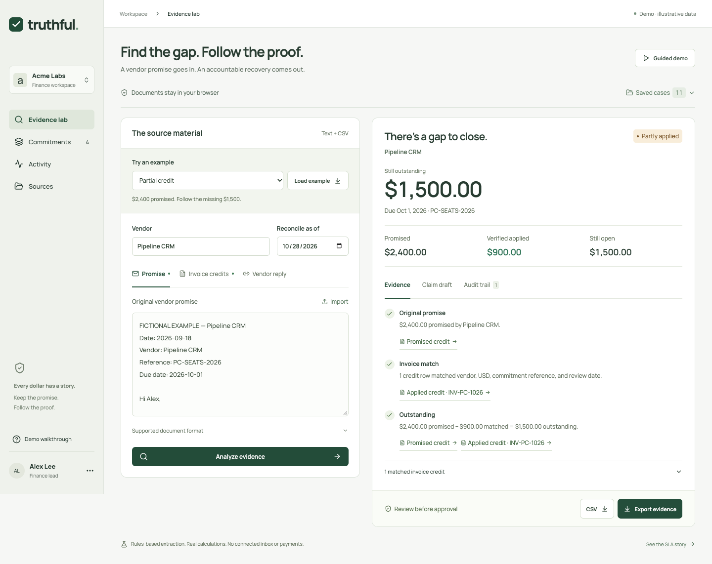

# Truthful · Team OVO

**A vendor promise is not a saving. Follow it until the credit reaches an invoice.**

Built for the BBS × Ramp Hackathon technical round. Truthful turns a vendor concession into an inspectable recovery case: original terms, matching invoice credits, a human-approved follow-up, and the evidence behind the result.



## Run it

Node 24 or later:

```sh
npm ci
npm run dev
```

Open **http://127.0.0.1:5173**. No API keys, accounts, or services are required. Choose **Partial credit → Load example → Analyze evidence**. Then change the matching invoice credit from `900.00` to `1000.00` and analyze again: the outstanding balance becomes **$1,400**.

## Two paths, one principle

| Path | What actually runs |
| --- | --- |
| **Evidence lab** | Processes supplied promise text and a positive invoice-credit ledger CSV. Matches vendor, USD, reference, and dates; retains exact source citations; rejects ambiguous inputs. |
| **Guided demo** | Replays a fictional SLA recovery: detect a covered outage, calculate $2,000, approve the claim, flag a renewal condition, and distinguish credit issuance from invoice application. |

The lab saves up to thirty cases in the current browser. **Claim draft → Approve claim** records the exact reviewed text. **Download draft** produces an unsent email file. **Export evidence** includes original sources, results, citations, and a hash-linked local audit history. **CSV** downloads a spreadsheet-safe summary. Source edits clear the previous result; saved cases can be reopened after reload.

**Wrong reference** and **Changed terms** demonstrate why a matching amount or a favorable vendor reply is insufficient proof. Example vendors and documents are fictional.

## Verify

```sh
npm run check
```

This runs financial/state tests, evidence and audit regressions, an authored synthetic fixture evaluation, the submission consistency check, and a production build. The evaluation is regression evidence, **not independent real-world accuracy**.

The same engine works without the UI:

```sh
npm run analyze -- --vendor "Pipeline CRM" --promise public/examples/pipeline-promise.txt --invoices public/examples/pipeline-invoices.csv --as-of 2026-10-28 --out /tmp/truthful-packet.json
npm run verify:packet -- /tmp/truthful-packet.json
```

Browser verification scripts use the Playwright CLI: open the running app, then run `scripts/browser-check.js` and `scripts/browser-edge-check.js` with `playwright-cli run-code --filename=…`. They exercise changed inputs, wrong references, approval/export, reload persistence, the full SLA flow, keyboard tabs, delayed-analysis cancellation, and mobile navigation.

## Implementation and trust boundaries

React 19, Vite 7, plain CSS, a dependency-free JavaScript evidence engine, integer-cent financial math, and browser Web Crypto. Runtime extraction uses explicit supported rules, **not a language model**. AI-assisted development is distinct from runtime AI.

The credit CSV is an applied-credit ledger with documented columns, not arbitrary invoice text. Source formats and examples are in [public/examples/README.txt](public/examples/README.txt). Unsupported terms, conflicting provenance, malformed rows, tentative amounts, future credits, and unknown replies require review. Only USD is supported. One credit row per unique invoice ID is required.

No inbox, Ramp account, vendor, payment system, or live LLM is connected. No messages, payments, or renewals are sent or accepted. Local storage is not authenticated accounting infrastructure. Hashes detect inconsistencies relative to the exported chain; they do not independently authenticate the source or reviewer. A person controlling the browser can construct a new record.

## Submission materials

- [Copy-ready Round 2 submission](docs/SUBMISSION.md)
- [Two-minute recording script](docs/DEMO_SCRIPT.md)
- [Architecture and engineering decisions](docs/ARCHITECTURE.md)
- [Product brief and roadmap](docs/PRODUCT_BRIEF.md)
- [Engineer Q&A](docs/JUDGE_QA.md)
- [Verified form requirements](docs/FORM_REQUIREMENTS.md)

The form requires a **public GitHub repository**, an accessible **Drive/Loom/YouTube recording**, and a **200–300 word architecture answer**. The prepared answer is checked against the actual shipped examples. Team consent, selected Round 1 track, and final attendance are team decisions; the application is not submitted automatically.

MIT license. Included source examples are synthetic.
