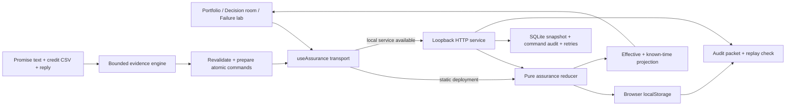

# Truthful v3 architecture

Truthful is a financial commitment assurance prototype. Its central object is a versioned obligation with conserved credit allocations, source lineage, proposed changes, and actions checked against current authority. The deterministic core runs in both the browser and an optional Node service.

## Runtime modes

| Mode | Persistence and enforcement | Boundary |
| --- | --- | --- |
| Local SQLite service | Real Node HTTP process, server-issued sessions, role checks, optimistic write revisions, atomic SQLite transactions, durable idempotent responses, replayable audit. | Selectable local demo identities are not organizational authentication. Only loopback interfaces/origins are supported. No external financial action. |
| Browser workspace | Same reducer and projections, stored in localStorage. Whole command batches validate before replacing the open/saved workspace. | The browser owner controls the data and selected role. No shared authoritative backend, independent identity, or managed backup. |
| Public GitHub Pages | Static application uses the labeled browser workspace fallback. | It does not run Node or SQLite. The public URL is not a hosted multi-user finance service. |

`npm run dev` starts the optional service and Vite together. `npm run dev:web` runs the frontend alone. Node 24 or later is required for the local service’s built-in SQLite support. Startup checks availability rather than treating configured code as a connected backend. The runtime banner names the active mode.

## Code map

| File | Responsibility |
| --- | --- |
| [`src/Assurance.jsx`](../src/Assurance.jsx) | Portfolio, source/version graph, replay dates, Decision room, branch decisions, ledger editor, mandate editor, and executable Failure lab. |
| [`src/useAssurance.js`](../src/useAssurance.js) | Service discovery, demo sessions, transport, revision handling, browser fallback, reset, and consistent export snapshot. |
| [`src/assurance/core.mjs`](../src/assurance/core.mjs) | Pure command reducer, temporal projection, financial checks, amendment branching, action simulation/approval/execution, and causal graph. |
| [`src/assurance/fixtures.mjs`](../src/assurance/fixtures.mjs) | Fictional four-vendor seed and its source-backed event sequence. |
| [`src/assurance/scenarios.mjs`](../src/assurance/scenarios.mjs) | Nine executable authored scenarios, including expected rejections and resulting-state assertions. |
| [`server/service.mjs`](../server/service.mjs) | Loopback HTTP, server actor context, CSRF/origin checks, SQLite transaction boundary, concurrency, durable retries, audit export/replay. |
| [`src/economics.mjs`](../src/economics.mjs) | Same-horizon renewal comparison from explicitly entered monthly cost assumptions. |
| [`src/assuranceImport.mjs`](../src/assuranceImport.mjs) | Revalidates evidence documents and prepares an atomic import, preserving the legacy adapter’s invoice identity. |
| [`src/Workbench.jsx`](../src/Workbench.jsx) and [`src/engine/index.mjs`](../src/engine/index.mjs) | Supported-format evidence ingestion, exact source spans, credit-ledger reconciliation, and the Add to portfolio path. |
| [`src/recovery.mjs`](../src/recovery.mjs) | Separate evidence-lab report snapshots, exact-draft approval, thirty saved reports, JSON/CSV/unsent EML exports. |
| [`src/domain.mjs`](../src/domain.mjs) | Earlier guided Nimbus SLA calculations and scenario replay; separate from the assurance workspace. |

## State and financial semantics

The assurance workspace is an append-only domain event sequence with a base policy and event revision. Inputs and commands are not mutated. Each accepted fact has an actor, observation time, financial effective date, command identity, and source/version references. Projection produces commitments, credit lines, allocations, amendments, actions, totals, and graph edges.

An issued memo can reserve credit capacity through allocation but contributes zero verified value. Application requires invoice evidence. All allocations share one credit-line capacity across cases. Exact vendor identity, USD currency, and commitment reference must agree. Multiple or absent candidates are quarantined until an approver records an explicit source-backed resolution. Verified attribution is capped by the accepted promise; excess applied value remains separately observable.

Reversals reduce ledger backing and the associated attribution. A partial reversal across several claims requires explicit causal allocation amounts. Recording/allocation/reversal/identity commands cannot be future-dated, closing the path where two invisible future allocations could each consume the same current capacity. Future due dates and approved future amendments remain supported.

## Versioned terms and authority

Conflicting pending amendments cannot silently overwrite the original agreement. Incompatible patched fields or renewal economics block acceptance. Finance dismisses an alternative with a retained reason/actor event, then prepares a fresh action. Proposals bind the accepted branch, current term revision, and supporting source versions. A fresh action cannot revive an intrinsically stale amendment.

A supported explicit replacement may supersede an accepted but not-yet-effective **nonfinancial schedule** amendment, naming its predecessor and covering every patched field. Renewal cancellation/replacement is outside that bounded model and is refused. All prior proposals, decisions, and replacement edges remain in history.

Actions pass through proposed, approved, stale/blocked, and locally executed states. Approval binds canonical action content, policy version/content, commitment revision, material event revision, and current source revisions. New material evidence, ledger facts, terms, or policy invalidate pending approval conservatively, even if the update concerns another case. Execution rechecks policy and current basis; it is one-use. A passing check records a local simulation, not a vendor transaction.

## Temporal projection

`evaluateWorkspace(workspace, {asOf, knownAt})` separates financial effective dates from observation time. A late-recorded amendment can change a retrospective assessment without appearing in an earlier knowledge view. Historical UI comparisons disable writes. The underlying export may retain the complete event history so the projection can be reproduced; a historical cutoff is a query, not an access-control boundary.

Missing evidence remains unknown. Bitemporal replay does not establish that an external source has finished posting, prove absence of a later application, or guarantee settlement finality.

## Evidence import and separate storage

The evidence lab accepts one explicit supported USD promise, a positive applied-credit CSV, and an optional reply. Exact citations use half-open JavaScript UTF-16 indices. The CSV is a credit-ledger adapter, not arbitrary gross-invoice understanding.

Add to portfolio reruns extraction against original documents, rejects unresolved conditions/replies, checks existing terms, and prepares source/commitment/credit/allocation commands. The legacy adapter has one credit per vendor invoice: changing its reference cannot invent a second line. Explicit multiple-line identities belong in the structured API. The batch commits entirely or leaves the portfolio unchanged. Importing facts does not transfer an evidence-lab email approval into assurance action authority.

The guided walkthrough state, the evidence lab’s thirty saved reports, and the assurance workspace are distinct stores. Reset controls describe their scope. An assurance service reset restores the seed while retaining server command audit history; browser reset replaces that browser workspace.

## Service, exports, and trust

The server derives actor/time from its session and clock, refuses client-supplied outer actor fields, and applies the same reducer. `expectedRevision` prevents a stale writer from overwriting newer state. SQLite commits snapshot, command audit entry, and cached idempotent response together. Identical requests with the same actor/key return the recorded response after restart; changed input under that key is rejected.

Server audit entries bind command, actor, timestamp, before/after state digests, revisions, and prior hash. Replay from the stored seed checks snapshot consistency. Browser-mode exports do not acquire server authority by containing the same event schema. Server-mode exports use the server’s returned workspace snapshot rather than a stale tab copy.

Hashes and replay check internal consistency relative to the supplied seed/history. They do not authenticate source issuers, verify an actual person, anchor time independently, or prevent a database owner from replacing and rehashing the entire record. Production identity, authenticated adapters, independent retention, and external action integrations remain outside this prototype. No live LLM, inbox, payment, vendor, or Ramp connection is claimed.

See [TECHNICAL_DEEP_DIVE.md](TECHNICAL_DEEP_DIVE.md) for invariants, adversarial sequences, API examples, and evaluation limits.
