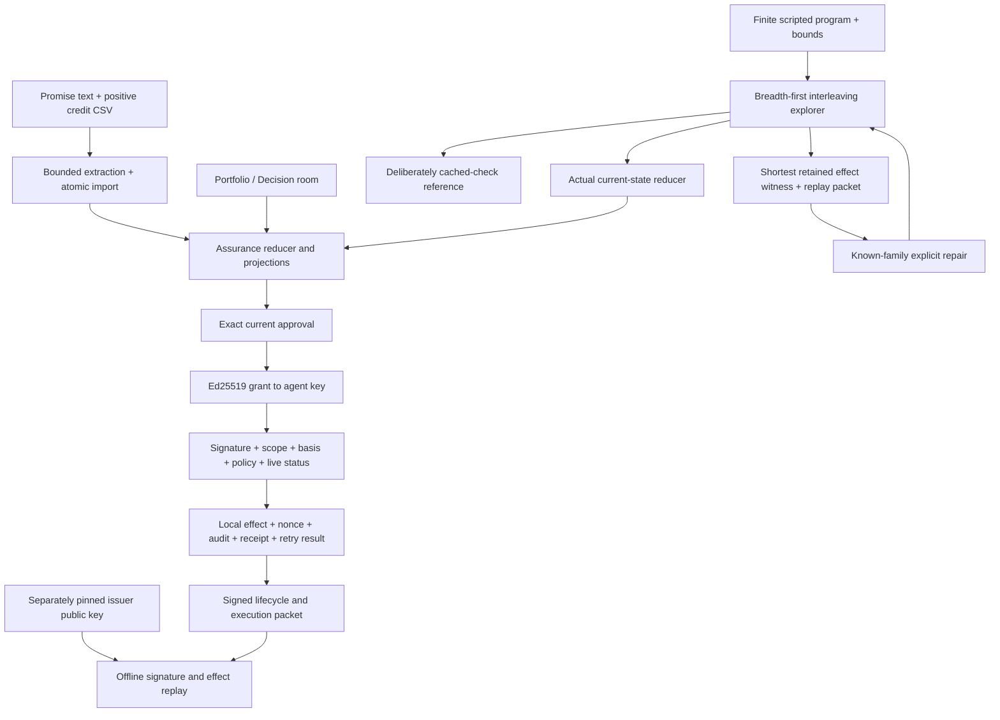

# Truthful v4 architecture

Truthful’s operator ritual is **test → inspect the counterexample → repair → approve → delegate → verify the recorded effect**. It combines a financial commitment model, a bounded scripted-program explorer, and a custom signed-authority boundary. The financial runtime is deterministic; no live LLM or external financial endpoint is connected.

## Runtime modes and data boundaries

| Surface/mode | Actual state and enforcement | What it does not establish |
| --- | --- | --- |
| Public static Assurance | Same financial reducer and browser-local portfolio persistence. | No authoritative shared backend or organizational identity. |
| Race explorer | Independent finite scenario initial states; naive and guarded execution of the same program/orderings. | Not a live model or competitor evaluation; it does not mutate the open portfolio. |
| Public Signed authority | Real Web Crypto Ed25519 signatures in an **isolated synthetic workspace**, with ephemeral keys and in-memory serialized use state. | It does not sign/modify the public persisted portfolio, survive reload, or provide independent server authority. |
| Optional local HTTP/SQLite service | Real sessions/roles, optimistic revisions, atomic batches, durable retries, audit replay, signed grants, live revocation, root-nonce consumption, and signed receipts. | Selectable demo human roles are not verified employees; loopback service is not a production hosted identity/payment platform. |

`npm run dev` starts Node and Vite together; `npm run dev:web` serves the frontend alone. The app detects live service availability and labels browser fallback. GitHub Pages serves static files, not Node/SQLite. Existing guided Nimbus and Evidence lab report stores remain separate from the shared assurance portfolio.

## Code map

| File/module | Responsibility |
| --- | --- |
| [`src/ExecutionLab.jsx`](../src/ExecutionLab.jsx) | Race explorer, finite-program editing, search verdicts, trace inspection, repairs, signed-authority workflow, pinned-key verification, and tamper demonstration. |
| [`src/explorer/index.mjs`](../src/explorer/index.mjs) | BFS schedule exploration, guarded/reference replay, shortest witnesses, bounded reports, fixed-family repair, and packet verification. |
| [`src/explorer/scenarios.mjs`](../src/explorer/scenarios.mjs) | Five explicit scripted families with actors, dependencies, initial evidence, goals, and properties. |
| [`src/useDelegation.js`](../src/useDelegation.js) | Agent keys, issuance/delegation requests, exact retries, revocation, UI packet export, and deliberate trust pinning. |
| [`src/authority/index.mjs`](../src/authority/index.mjs) | Strict custom profiles, canonical/domain-separated signing, Ed25519 verification, attenuation, key possession, current-basis checks, and offline effect replay. |
| [`src/authority/memory.mjs`](../src/authority/memory.mjs) | Separate ephemeral browser authority workspace; serialized lifecycle and one-use execution. |
| [`server/authority.mjs`](../server/authority.mjs) | Persisted issuer, grants, revocation, atomic delegated execution hooks, lifecycle records, receipts, and signed checkpoint export. |
| [`server/service.mjs`](../server/service.mjs) | Loopback HTTP/session boundary, SQLite transaction ownership, revisions, retries, audit replay, and authority routes. |
| [`src/Assurance.jsx`](../src/Assurance.jsx), [`src/useAssurance.js`](../src/useAssurance.js) | Portfolio, Decision room, earlier Failure lab, history/graph/ledger controls, service transport, and browser fallback. |
| [`src/assurance/core.mjs`](../src/assurance/core.mjs) | Financial event reducer, conserved allocations, temporal projection, branch decisions, and canonical approval basis. |
| [`src/assuranceImport.mjs`](../src/assuranceImport.mjs), [`src/engine/index.mjs`](../src/engine/index.mjs) | Source revalidation, supported text/credit-ledger processing, exact spans, stable legacy invoice identity, and atomic promotion. |

## Search semantics

A finite plan specifies initial state/time, ordered actor programs, optional dependencies, a goal, and fixed financial/authorization properties. Operations include speculative `check`, cached `commit`, actual current-state `command`/`atomic`, and explicit simulation-clock advancement.

The reference commits cached reducer events without rechecking current state. The guarded path calls the real reducer at effect time. Both receive identical programs and eligible schedules; no alternate credit math is substituted. Full workspace/history, program counters, clock, and cached observations enter canonical state identity; equal balances do not merge distinct histories.

BFS retains a shortest unsafe-effect prefix within the supplied plan and explored bounds. Rejected invalid attempts are successful guards, not invariant failures. Depth, states, transitions, and wall time are bounded. A cutoff is inconclusive; absence of a witness does not generalize beyond the explored model. The verifier checks digest, retained traces/effects, and search counts; time-cutoff reports reproduce the exact deterministic BFS prefix.

Repairs are deterministic transformations for unchanged authored families. Custom/edited programs can be explored and replayed but receive `repair:null`, not an unrelated template. Completion and unsafe effects are separate results. Deadline repair preserves both clock orderings: one completes, one correctly refuses expired authority.

## Signed authority and atomic effect

The custom grant binds issuer/key ID, workspace/audience, one exact approved action/commitment/vendor/currency, agent public key, action/full-approval-event/basis digests, maximum claim amount, maximum incremental obligation, validity window, and shared root nonce. Unknown caveats fail closed. The maximum claim is a bound on the modeled action amount, **not a literal new-spend budget**.

A child is signed by its parent agent and can narrow amount/lifetime while preserving the action, audience, basis, and obligation constraints. A signed request proves possession of the leaf key. The local server rechecks current approval, policy, time, revocation, scope, revision, and unused root under the same SQLite write transaction as the reducer effect, consumption, audit, signed receipt, and cached response.

An identical committed retry returns its prior receipt, even after subsequent expiry/revocation; it is not a fresh execution. A new use of the consumed root is rejected, including through another child. Signing a valid grant does not revive a stale approval. Outstanding roots are permanently revoked atomically on a demo reset, preventing reused seeded IDs/approvals from resurrecting authority. The UI’s original-terms action records no new savings or external transaction.

## Financial foundation

Credits have one shared capacity after reversals. Exact identity and source-backed ambiguity resolution constrain allocation. Issued memos reserve capacity but verify nothing until invoice application. Verified attribution is capped by accepted promise value. Reversals are causal new records, not deleted history.

Competing amendments require reasoned dismissal and a fresh current review. Proposals bind accepted branch/source versions; fresh actions cannot revive stale proposals. Supported explicit supersession is bounded to accepted future nonrenewal terms without creating/cancelling a renewal obligation. Effective and known-time projections retain historical knowledge without claiming source completeness. Material updates invalidate pending approvals conservatively.

## Verification formats are separate

| Packet | Verifier |
| --- | --- |
| Assurance workspace/server export | `node scripts/verify-assurance-packet.mjs packet.json` replays complete domain commands and compares projections/invariants/server record when present. |
| Exploration report | `node scripts/verify-exploration.mjs --check report.json` replays retained schedules and bounded search/prefix claims. |
| Signed authority evidence | `node scripts/verify-authority.mjs packet.json --trust pinned-issuers.json` verifies a separately trusted issuer, lifecycle, grant/request signatures, and actual reducer effect. |
| Earlier Evidence lab report | `node scripts/verify-packet.mjs packet.json` verifies that separate report/draft hash-chain format. |

A self-selected embedded key is not a trust anchor. Pinning the synthetic lab issuer deliberately is a demonstration trust decision, not proof of an organization’s identity. Offline signatures attest the included recorded history/effect at a checkpoint; they cannot establish current revocation, global unspentness across forks, source authenticity, external settlement, or completeness of omitted history.

The project does not implement AP2/UCP/MCP/A2A conformance, passkeys, post-quantum signatures, a general synthesizer, an SMT/TLA+ proof system, or a live-model benchmark. See [TECHNICAL_DEEP_DIVE.md](TECHNICAL_DEEP_DIVE.md) for APIs/invariants and [FRONTIER_RESEARCH.md](FRONTIER_RESEARCH.md) for dated primary sources and the limits of the wedge.
