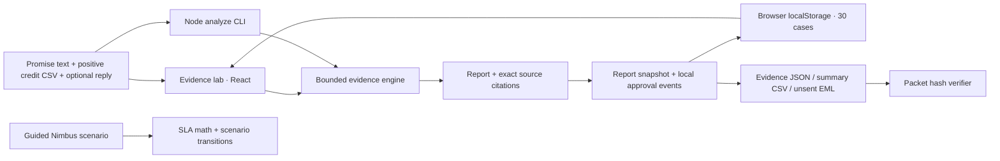

# Truthful architecture

Truthful runs its financial processing in the browser. The same evidence engine is callable from Node. It has no backend, account authentication, runtime LLM, connected inbox, or payment authority.



## Code map

| File | Responsibility |
| --- | --- |
| [`src/App.jsx`](../src/App.jsx) | Shell, navigation, guided cases, and scenario actions. Evidence lab is the initial surface. |
| [`src/Workbench.jsx`](../src/Workbench.jsx) | Text/CSV inputs, examples, import, analysis results, citations, draft review, saved cases, and export controls. |
| [`src/engine/index.mjs`](../src/engine/index.mjs) | `extractPromise`, `parseInvoiceCsv`, and `analyzeEvidence`: bounded extraction, date/identity validation, matching, financial totals, warnings, and proposed draft. |
| [`src/recovery.mjs`](../src/recovery.mjs) | `createCase`, `approveCase`, `verifyCase`, local storage helpers, evidence packets, CSV summary, and approved unsent email draft. |
| [`src/domain.mjs`](../src/domain.mjs) | Prepared Nimbus SLA arithmetic and guided scenario state transitions. Separate from imported-evidence processing. |
| [`scripts/analyze.mjs`](../scripts/analyze.mjs) | Reads local files, runs the engine, and creates a JSON evidence packet. |
| [`scripts/verify-packet.mjs`](../scripts/verify-packet.mjs) | Checks report and audit hashes in an exported packet. |
| [`src/engine/evaluate.mjs`](../src/engine/evaluate.mjs) | Authored synthetic fixture regression report, explicitly not held-out validation. |
| [`scripts/verify-submission.mjs`](../scripts/verify-submission.mjs) | Checks the written architecture length and key demonstrated results against shipped fixtures. |

## Evidence processing

The input is **one commitment**, not an entire mailbox or invoice archive. The selected vendor and review date provide explicit context. The promise must contain a supported confirmed USD credit, refund, or fee-waiver sentence, one amount, a commitment reference, and a supported due date. A `Vendor:` header, when present, must match the selected vendor. A valid `Date:` header prevents a later promise from matching earlier credits. Undated promises produce a provenance warning.

Invoice input is a **positive credit ledger** with these headers:

```csv
invoice_id,vendor,date,description,amount,currency,commitment_ref
```

`900.00` means a $900 applied credit, not a gross invoice total, a negative charge, or a credit memo awaiting application. The person or future adapter providing this ledger must preserve that semantic distinction. The engine checks the supplied representation; it does not independently prove settlement.

Matches require the vendor after trimming/case normalization, USD currency, the exact commitment reference, and a date no later than the review date. A dated promise also excludes rows predating the promise. Identical repeated rows with the same invoice ID count once. Different rows sharing one invoice ID are a conflict: use one credit row per invoice, or distinct valid IDs. This bounded policy does not support arbitrary multi-line credit allocation.

Amounts are parsed into nonnegative safe integer cents. Invalid numeric formats, unsafe ranges, nonpositive credit rows, malformed CSV, and invalid dates require correction. Outstanding is floored at zero. Excess credits are surfaced separately, and attributed verified value is capped at the promised amount.

Every citation retains the exact original text and a half-open range. Offsets are **JavaScript UTF-16 string indices**, so `source.slice(start, end) === quote`. They are not byte offsets or Unicode code-point counts.

## Terms and decisions

An original conditional offer is excluded from verified savings. A later detected condition is kept separate from the original promise; previously matched credits remain observable. No renewal or other new obligation is accepted. Reply text outside the recognized condition patterns is retained for manual review; failure to detect a phrase is not evidence that the reply contains no changed terms.

Future commitments are scheduled, not presented as due recovery drafts. Unknown, denied, tentative, multi-amount, missing-reference, ambiguous-date, and foreign-currency promises require correction rather than a confident financial claim. `$` without an explicit currency is treated as USD with a warning in this USD-only prototype. These are bounded rules, not general language understanding.

## Snapshots, approval, and persistence

Analysis creates a report snapshot and an `EVIDENCE_ANALYZED` event containing its SHA-256 digest. Each event includes its sequence, timestamp, previous hash, payload, and hash. A local reviewer can edit a proposed draft and approve it. The approval records the **exact text** and its digest, tied to the analyzed report. Repeat approval does not replace that text. Unsupported, already fulfilled, or originally conditional cases cannot be approved for recovery.

Editing an input clears the current result, so a stale calculation cannot be approved as if it describes the edited documents. Reanalysis creates a new snapshot. Saved cases retain up to thirty reports in browser `localStorage`; reopening one checks its hashes and restores its analyzed inputs and approved draft. Unanalyzed edits are not saved cases. Storage failure leaves the open case available for export and displays a recovery message.

The outputs have different purposes:

- **Evidence JSON**: original documents, complete report, citations, matches/exclusions, and local hash-linked events.
- **CSV**: a monetary/status/approval summary, with escaping and spreadsheet-formula protection.
- **EML**: the exact approved draft with `X-Unsent: 1`; downloading does not send it.

## Trust and security boundary

All supplied evidence remains in the browser during processing; example files are fetched from the app’s own static assets. Exporting a packet deliberately includes the original documents. The local saved-case store is not an authenticated accounting system or a secure shared vault.

Hash verification detects a changed report, draft, or event relative to the exported chain. It does not establish source authenticity, reviewer identity, trustworthy timestamps, authorization outside the app, or an independently immutable audit trail. Someone controlling the browser or packet can recompute an entirely new chain. Production requires authenticated actors, server-enforced permissions, source lineage, retention/deletion controls, and an independently protected event store.

Source text has no execution authority. There is no external email, purchasing, payment, or accounting writeback tool. A future model extraction layer would need constrained outputs, validated citations, adversarial testing, and the same deterministic approval boundary; none of those future integrations is implied by this build.

## Verification

`npm test` exercises financial boundaries, extraction and matching, approval snapshots, local storage, and hash-integrity failures. `node src/engine/evaluate.mjs` reports authored fixture regressions by supported, mixed, and adversarial groups. `npm run verify:submission` reconciles recorded demo expectations with the actual fixture engine. `npm run build` creates the static production bundle.

Those checks are evidence about the included cases and implementation. They are not an accuracy benchmark on unseen customer documents, a security certification, or proof of recovered customer money. Browser walkthrough evidence is recorded separately by the lead.
