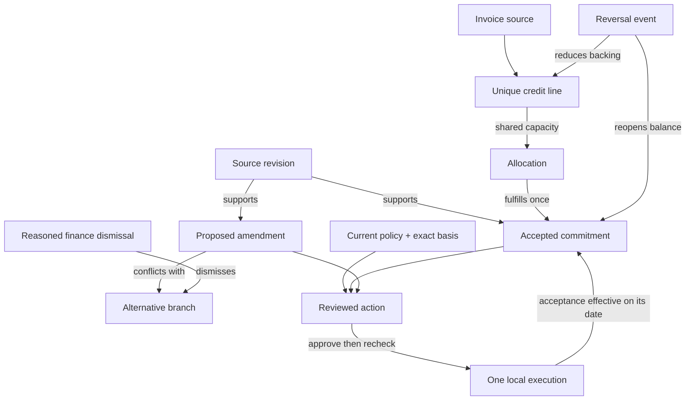

# Truthful v4 technical deep dive

Truthful tests a financial plan before its effect commits, then binds a permitted execution to exact current authority. Beneath that workflow are three financial questions that a single “savings” answer can conceal:

1. What do the recorded sources and accepted terms say is owed?
2. Which applied credit capacity can be attributed to that obligation?
3. Is this exact proposed action still authorized now?

The implementation combines a deterministic event model, shared credit accounting, version-bound decisions, a bounded interleaving explorer, fixed-family plan repairs, and real Ed25519 delegated execution. The optional transactional service persists the actual effect and signed execution record together. The model is not an accounting authority over unverified external reality.

## 1. The complete mechanism



These relationships are emitted from the same records used for projection and validation. The graph is not a separate picture of invented state. Sources retain revisions; rejected proposals remain present; decisions name the branch and actor they concern.

## Before the effect: explore, explain, repair

[`src/explorer`](../src/explorer/README.md) takes an explicit finite scenario: initial workspace and clock, actor-specific ordered steps, optional cross-step dependencies, goal, and fixed financial properties. The grammar is `check`, `commit`, `command`/`atomic`, and `advanceTime`. It is a scripted program checker, not an LLM agent evaluation or general program synthesizer.

Breadth-first search enumerates enabled interleavings while preserving each actor’s order and dependencies. Full workspace/event history, program counters, clock, cached checks, and observation history enter canonical state identity. Equal balances do not merge different histories; deduplication is not based on a potentially colliding hash. There is no partial-order reduction. Two actors with two ordered steps have six complete schedules.

The deliberately naive reference speculates through the actual reducer at `check`, then later rebases the cached events without current validation. The guarded path calls the real reducer at commitment. Both receive identical scripts and schedule orders. Immediately before a cached effect, the real reducer acts as the current-state oracle. A cached effect rejected by that oracle is an observable unauthorized effect; workspace conservation is checked separately. An ordinary rejected attempt is a functioning boundary, not a safety failure. This reference is intentionally broken teaching code, not a competitor, model, or representative industry baseline.

BFS retains the shortest unsafe-effect prefix under that finite model and declared step semantics. Depth, states, transitions, and wall time are bounded. Any cutoff is inconclusive about absence of failures, even if a valid witness was found. Exhaustive means every enabled ordering of this supplied finite program was explored, not unbounded financial safety.

`verifyExplorationPacket` checks the digest and independently replays trace commands, oracle decisions, state, and effects. It reruns search to compare witnesses, shortestness, counts, and completion fields. For wall-time cutoff it reconstructs the exact recorded BFS expansion prefix deterministically, rather than accepting a self-consistent recomputed digest. The packet’s initial facts and actors remain supplied premises.

### Repair must preserve the job and authority

Only unchanged authored scenario families receive a deterministic catalog repair. Edited or unknown custom plans can be explored/replayed but return no automatic repair. The repair cannot invent a vendor promise, enlarge capacity, remove the competing actor, or let an executor approve its own work.

| Family | Implemented continuation | Honest utility limit |
| --- | --- | --- |
| Two consumers, one credit | Keep both distinct request/allocation IDs; each allocation performs current capacity check and commit atomically. | One $900 allocation succeeds, the other is refused. Two intentions cannot manufacture $1,800. |
| Changed evidence | Wait for the fixture update, let the analyst propose anew, obtain distinct finance approval, then commit. | Assumes the modeled approver is available; new unmodeled changes are not guaranteed to finish. |
| Competing amendment | Finance explicitly dismisses the rival with a retained reason; fresh proposal, approval, and execution follow. | The rejected branch remains in history; executor does not gain dismissal authority. |
| Deadline | Recheck atomically without removing either adversarial clock order. | One of two terminal orders safely completes. The expired order stays blocked; no deadline extension is synthesized. |
| Benign completion | Execute through the actual atomic boundary. | Limited to the supplied initial state, steps, and goal. |

Reports count safe terminal goal completions separately from rejected attempts and absence of unsafe effects. Those schedule counts are not independent statistical samples or a measured customer completion rate.

## At the effect: exact signed authority

[`src/authority/index.mjs`](../src/authority/index.mjs) implements a custom Ed25519 profile with strict field schemas, canonical signing bytes, explicit domain separation, and unknown-caveat rejection. A root grant binds issuer/key ID, workspace and audience, one `EXECUTE_ACTION`/action ID, commitment/vendor/currency, exact action, full approval-event, and approval-basis digests, agent public key, amount and obligation limits, validity window, and a shared root nonce.

The displayed **Maximum claim** limits the modeled claim amount; it is not a payment/spending budget. The hero action preserves original terms and records an execution, not recovered cash. A child grant may narrow the amount/obligation limits and time window and change the target agent key. It cannot change the action, basis, workspace, audience, or root nonce. The chain allows one root and at most three children. The parent agent signs the child grant; the final agent signs an execution request, proving possession of the leaf private key.

The live gate verifies the issuer chain and request, current exact approval/action basis, current policy, expiry, revocation, scope, and unconsumed root nonce. A valid signature alone is insufficient. All sibling delegations consume the same root capability. Material source/policy changes can invalidate a grant without altering its signed bytes.

In [`server/authority.mjs`](../server/authority.mjs), signatures are checked before the write transaction; all current-state authorization checks occur inside the same SQLite `BEGIN IMMEDIATE` transaction as the real reducer effect, root-nonce consumption, authority audit, signed receipt, and cached retry response. Failure rolls the whole write back. Identical successful retry returns the previously committed response, including after expiry/revocation; it grants no new execution. A new request using the consumed root fails. The human issuing/revoking a grant uses the server’s demo session; the execution endpoint accepts signed agent possession rather than a client-supplied role.

The full approval digest binds the approving actor/event as well as the basis. A server reset permanently revokes outstanding roots in the same transaction as reset/audit; recreating seeded action IDs or even identical approvals cannot revive an old grant. Injected lifecycle-write failure rolls the reset and revocation back together.

The local issuer private key is stored in the demo SQLite configuration. Browser agent private keys are generated for the tab. This is real cryptography, not production key custody, organizational identity, a passkey, post-quantum security, or a standards-conformant agent-payment protocol.

### Public browser versus durable service

The static public build has no Node backend. Its finance portfolio is local browser state. Its **Signed authority** lab creates a separate synthetic workspace, ephemeral issuer/agent keys, and serialized in-memory execution through [`memory.mjs`](../src/authority/memory.mjs); it does not sign or modify that browser portfolio and is lost on reload. A pinned demo issuer means the user explicitly trusts that local demo key, not that the key belongs to a real organization.

Optional local service mode operates on the actual SQLite workspace with durable grants, consumption, audit, and retries. The UI labels the mode. Neither mode performs external payments, emails, vendor changes, or settlement. The explorer likewise uses its supplied synthetic workspace rather than mutating the operator’s portfolio.

## 2. Event model and deterministic replay

The workspace has `schemaVersion`, `id`, a base policy, a domain revision, and `events`. Domain revision counts events, not HTTP requests. Each event contains sequence/ID, originating command identity and canonical content, type/payload, actor, observed instant, effective date, and whether it changes material decision state.

`reduceWorkspace(state, command, {actor, now})` either returns a new serializable state/result or throws a typed `DomainError`. It does not mutate inputs, read the clock, generate random IDs, or call services. A service supplies trusted context relative to its own demonstration boundary. `evaluateWorkspace` derives the financial view rather than relying on mutable cached totals.

An explicit command ID provides reducer retry identity: same ID/content yields the prior effect without another event; changed content conflicts. Server HTTP idempotency is a separate durable request boundary, described below. One accepted amendment creates both an acceptance event and an action-execution event, so its domain revision can advance more than one.

### Time has two axes

- `asOf`: the financial date whose effects are being evaluated.
- `knownAt`: the latest observation included in that evaluation.

An invoice application effective November 1 but observed November 3 must not appear in a November 2 knowledge view. A late accepted amendment effective October 15 can change a later retrospective assessment of October 29 while leaving an earlier knowledge view intact.

Projection is an interpretation of recorded evidence, not a declaration of complete feeds. There is no implemented posting watermark or source-lateness guarantee. “Not observed” is not proof that money is lost. The UI’s historical dates are read-only comparisons; exports can retain the complete underlying trace so both views are reproducible. They are not a historical-data access-control system.

Future due dates and approved future amendments are valid. Already-effective financial/identity recording commands cannot be future-dated. This intentionally avoids accepting two hidden future allocations against the same current unallocated credit.

## 3. Money and globally shared credit

Every modeled monetary amount is a safe integer count of USD cents. The bounded text parser accepts decimal credit amounts and converts them before arithmetic. Unsupported formats, unsafe ranges, and foreign currency do not become a financial assertion.

For a credit line:

```text
available = face amount − reversed amount
allocated = sum(active allocations across all commitments)
unallocated = available − allocated
0 ≤ allocated ≤ available
```

For an unconditional commitment:

```text
verified = min(accepted promised amount, eligible applied allocation)
outstanding = max(0, promised − verified)
verified + outstanding = promised
```

Issued allocations reserve capacity but do not contribute applied value. Conditional offers remain excluded until their terms are resolved in the modeled workflow. Excess credit is observable and does not inflate attributed verified value beyond the accepted promise. Allocation identity must agree on vendor ID, USD currency, and commitment reference.

### Identity and ambiguity

The structured API treats credit IDs as ledger-line records and preserves an optional external `lineId`. A vendor/invoice/line cannot be registered under another credit alias. Multiple real lines can share an invoice if the adapter supplies distinct identities. The system cannot prove those assertions describe real external lines.

The legacy evidence CSV has no line column. Its adapter therefore supports **one credit per vendor invoice**, with stable identity independent of the commitment reference. Importing the same invoice under a changed reference is a conflict, not a second $900. A multi-line invoice requires the explicit command/API path.

A credit with zero or several exact candidate commitments is quarantined. An approver can `RESOLVE_CREDIT` using supporting evidence and per-commitment limits. Resolution cannot override vendor/currency/reference identity, erase existing active attribution, or expand credit capacity.

### Reversals

A reversal is a new event, not deletion. It reduces the available credit and revokes allocation backing where needed. Unallocated capacity disappears first. A full reversal reopens all affected balances. When several claims share a credit and only some backing disappears, finance must name the allocation reversal amounts; the engine refuses to choose an arbitrary losing claim.

## 4. Competing and changing obligations

`PROPOSE_AMENDMENT` preserves the original promise. Allowed patches are amount, due date, claim deadline, and conditions; vendor/reference/currency identity cannot change. A proposal stores source versions, the current commitment revision, and accepted-branch IDs.

Pending proposals with disagreeing overlapping fields or different renewal economics are incompatible. Their conflict IDs appear in the projection and graph. Acceptance is blocked until an approver/admin records `DISMISS_AMENDMENT` with a reason. Dismissal retains source, proposal, actor, reason, observation time, and event lineage. It does not accept another branch or erase previously accepted terms.

The proposal’s own `basisStale` check is separate from an action’s stale approval. Accepting another branch or changing the proposal’s supporting source can make it intrinsically stale. Creating a fresh action around that old proposal does not revive it; finance must record a new current proposal.

Accepted future schedules also cannot be implicitly overwritten. A supported explicit replacement names `supersedesAmendmentIds`, concerns the same commitment, and covers every predecessor patch field. This bounded mechanism supports not-yet-effective **nonfinancial** schedule changes. Replacing/cancelling an accepted renewal obligation is refused. Once the replacement takes effect, the earlier schedule remains in lineage but cannot silently reapply later.

A minimal current-branch acceptance sequence on the fictional seed is:

```js
import {createDemoWorkspace, reduceWorkspace} from '../src/assurance/index.mjs';

let workspace = createDemoWorkspace();
const context = {
  actor: {id: 'local-demo-admin', role: 'admin'},
  now: '2026-10-29T12:00:00.000Z',
};
const commands = [
  {type: 'DISMISS_AMENDMENT', amendmentId: 'amendment-pipeline-renewal',
   reason: 'Decline the renewal; review the date change under the original agreement.'},
  {type: 'PROPOSE_ACTION', action: {id: 'review-current-date',
   commitmentId: 'pipeline-seats', type: 'accept_amendment',
   payload: {amendmentId: 'amendment-pipeline-date'}}},
  {type: 'APPROVE_ACTION', actionId: 'review-current-date'},
  {type: 'EXECUTE_ACTION', actionId: 'review-current-date'},
];
for (const [index, command] of commands.entries()) {
  workspace = reduceWorkspace(workspace, {id: `example-${index}`, ...command}, context).state;
}
```

The import path in this illustrative snippet is relative to a file in `docs/`; adjust it when running from another directory. The modeled due-date change takes effect November 1, not at the time of approval. No external contract is executed.

## 5. Approval is a bound capability in this model

The supported action types are `prepare_claim`, `preserve_original`, and `accept_amendment`. A simulation produces a policy decision and, where relevant, explicit economics. It does not itself authorize an effect.

The action/approval basis binds:

- Canonical action type, target, and payload.
- Commitment revision and material workspace revision.
- Current policy version and canonical policy content.
- Current source IDs and revisions.

Proposal, approval, and execution are separate commands. Approval requires an approver context. Execution requires an executor context, an approval for that exact action, a still-current basis, and a passing current policy check. Completed actions are one-use. An expired claim deadline can block execution as time passes even without a new material event.

Material updates conservatively invalidate pending approval across the workspace, including unrelated cases. This is sound but can require unnecessary re-review. Narrower dependency-based invalidation is a production optimization to validate, not a capability silently claimed here.

Roles are viewer, analyst, approver, executor, and explicit demo admin. The admin convenience can perform all phases. The current service does not verify employees or enforce separation of duties between real humans.

## 6. Deal economics is not a savings label

Pipeline’s existing $2,400 correction already has $900 verified, leaving $1,500 contingent in the new offer. The stated counterfactual is twelve months of equivalent service at $6,000/month. Proposed spend is $6,200/month:

```text
Baseline:                     $72,000
Proposed annual spend:        $74,400
Incremental spend:             $2,400
Remaining contingent credit:   $1,500
Net incremental value:          −$900
```

The $900 already applied is not counted as a new negotiation benefit. The comparison’s baseline is an explicit scenario assumption, not a verified quote. Editable monthly/horizon inputs in Decision room recompute a what-if; they do not mutate the stored proposal or authorize it.

When a renewal is explicitly authorized in the model, effective and future incremental obligations remain separate from verified credit. `netVerifiedValueCents` subtracts effective agreed incremental cost under that baseline. It is not a bank cash-flow statement. Taxes, FX, discounting, cancellation rights, and uncertain service value are not inferred.

## 7. Atomic evidence promotion

The Evidence lab remains useful because financial assurance needs an entry path beyond prepared fixtures. It processes supported USD promise text, positive credit-ledger CSV, and an optional reply. Citations preserve exact half-open UTF-16 source ranges.

Add to portfolio calls `prepareEvidenceImport`:

1. Rerun extraction from original documents rather than trusting a modified report object.
2. Reject unsupported evidence, unresolved conditions/replies, and future review assertions.
3. Locate the normalized vendor and exact commitment; reject term mismatch rather than silently rewriting it.
4. Preserve a stable legacy invoice identity and reject amount/reference conflicts or uncertain multi-line matches.
5. Prepare source, commitment, credit, and allocation commands as one batch.

Browser mode adopts/persists only a fully successful batch. The optional service commits the batch and audit within one transaction. A final rejected allocation leaves no earlier source or ledger mutation. An evidence-lab approval of an email draft is not promoted as assurance approval authority; the assurance action needs its own current basis.

The evidence lab’s thirty saved reports and exact-draft JSON/CSV/EML exports remain separate from the assurance event workspace. The original guided Nimbus demonstration is another separate illustrative state machine.

## 8. Real HTTP and SQLite boundary

The optional service uses Node 24 built-ins. It binds loopback only; the static public deployment does not include it. The UI selects server mode only after a live session/workspace response and labels browser fallback explicitly.

| Boundary | Implemented behavior |
| --- | --- |
| Session | Random server-issued HttpOnly, SameSite=Strict local cookie and an eight-hour expiry; sessions persist in SQLite. |
| Actor | Actor/role come from the server session. Outer actor spoofing is refused; nested client actor fields do not replace reducer context. |
| Mutation origin | Explicit HTTP loopback Origin plus CSRF token required. Host checks constrain DNS-rebinding exposure. |
| Concurrency | Current server write revision required through `expectedRevision` or `If-Match`; stale writes conflict. |
| Batch | 1–200 domain commands validate/commit together or roll back. Internal reset/batch command types cannot be injected through the public command route. |
| Retry | Actor/idempotency-key request digest is persisted with the exact response. Identical retry survives restart; different input under the same key conflicts. |
| Audit | Snapshot, accepted command entry, and cached response commit in one SQLite transaction. |
| Reset | Explicit demo-admin confirmation restores the seed and appends a reset audit entry; it does not delete server history. |

The HTTP revision counts accepted writes. Domain revision counts emitted domain events. A multi-command batch advances the former once and can advance the latter many times. They are deliberately not interchangeable.

Key data routes are `/api/workspace`, `/api/commands`, `/api/batch`, `/api/events`, `/api/export`, and `/api/verify`. See [server README](../server/README.md) for request shapes and the exact reset confirmation. This is real transport/storage enforcement around selectable demo identities, not production authentication.

## 9. What export verification establishes

Different formats make different claims. A digest detects changes relative to its recorded content; it does not authenticate a vendor or stop a database owner from rewriting an unsigned history. Signed authority adds a verifier’s separately trusted local issuer, not independent truth about the outside world.

```sh
# Financial command replay and selected projection; server audit when present:
node scripts/verify-assurance-packet.mjs /tmp/truthful-assurance-evidence.json
# Reproduce the finite program, its witness/counts, and cutoff prefix:
node scripts/verify-exploration.mjs --check /tmp/truthful-exploration.json
# Supply trusted issuer keys separately from the untrusted signed packet:
node scripts/verify-authority.mjs /tmp/truthful-authority-evidence.json --trust /tmp/truthful-pinned-issuer.json
# Earlier evidence-lab citations, arithmetic, and local hash links only:
node scripts/verify-packet.mjs /tmp/truthful-evidence-packet.json
```

The assurance verifier replays complete commands and validates the outer selected view/invariants. A server export also includes the seed, current snapshot, accepted commands/actors, projection context/result, HTTP revisions, state digests, previous-hash links, and export digest. Server-mode wrappers are built from the returned server snapshot, avoiding an old-tab/new-server mismatch. Browser packets cannot claim a server record they do not have.

The authority verifier requires a separately supplied array of `{issuer,keyId,publicKey}`; it never treats the packet’s claimed public key as its own trust anchor. It verifies the signed checkpoint, lifecycle, grant chain, possession requests, receipts, root-nonce consumption, exact financial before/after states, reducer authority, and replayed effects. Unknown root, changed signature, modified effect, scope escalation, or inconsistent included history fails.

A successful offline check establishes consistency and authenticity relative to that explicitly trusted issuer and included checkpoint. It cannot establish current revocation, global unspentness across cloned databases, omitted history beyond the checkpoint, organization identity, vendor authenticity, independently trusted time, or external settlement. A receipt proves a recorded past effect under those premises; it is not a fresh permission to execute again.

## 10. Validation and reproducibility

At the inspected component checkpoint, the assurance-domain suite has thirty-eight tests; nine authored scenarios execute thirty-one checks. The explorer has fourteen tests over five scenario families; the authority and authority-HTTP checks together have thirty targeted tests. These component counts are separate checkpoints. The lead’s integrated `npm run check` checkpoint passed 145 tests, the existing 22 extraction fixtures and 9 assurance scenarios/31 checks, 843 command-prefix/date accounting checks, and the v4 acceptance described next. Subsequent release changes and publication status belong in [DELIVERY.md](DELIVERY.md). The suite includes seeded adversarial event sequences and regression cases for future allocation, invoice aliases, amendment conflicts, stale bases, supersession, reversal attribution, and exact role/policy decisions. Real HTTP tests separately exercise transaction rollback, concurrency, actor context, persistent retries, reset retention, and replay.

```sh
npm run evaluate:assurance
node scripts/verify-exploration.mjs
npm run verify:submission
```

The v4 authored acceptance verified fifteen reports across five families, including four unsafe cached-reference witnesses, 121 visited search states, and 106 transitions across reports. These counts include shared fixture prefixes and are not independent cases, throughput, or elapsed-latency results. Browser acceptance passed twenty-three assertions in each of actual SQLite mode and production-preview isolated browser mode; actual exported authority packets passed the standalone pinned-root CLI. Desktop/mobile captures were inspected, with final review/publication recorded by the lead.

Full integrated acceptance is `npm run check`, run by the lead against the combined patch. Browser inspection is needed to verify that the UI exposes the correct state and recovery path; a unit test cannot establish visual clarity. [DELIVERY.md](DELIVERY.md) records publication and integrated verification without conflating older v2/v3 recordings with the v4 workflow.

The scenarios are authored synthetic regressions. They are not an independent accuracy benchmark, a formal proof, actual competitor results, or customer recovery evidence. A model integration would need declared model/version/schema/budget, repeated-trial effect checks, and independently reviewed held-out cases. A pilot must measure unsafe effects, false blocks, legitimate completion, review effort, and incremental applied credits against the existing process.

## 11. What is not implemented

There is no live LLM, financial connector, vendor identity verification, external send/payment/renewal execution, organizational authentication, independent audit anchor, feed-completeness guarantee, or universal legal/financial interpretation. Multi-currency, tax/FX, arbitrary OCR, real settlement validation, and cancellation of an accepted renewal require separate domain and integration support.

The concrete claim is inspectable: under supplied evidence and explicit finite programs, Truthful finds and replays actual unsafe cached effects, compares the real reducer, reports bounded repair utility, and commits an exact delegated local action once. Financial conservation, current basis, and authority are checked at the effect boundary. No unbounded or real-world safety theorem follows.


## Development integration: current portfolio actions

`src/explorer/portfolio.mjs` builds a finite scenario from a recorded, current approved action with an explicit simulation instant. It rejects missing, unapproved, stale, executed or policy-ineligible actions. The original workspace is cloned without adding approvals. Metadata retains workspace/action identity, the exact approval basis, domain revision and current source-revision IDs.

The operator can add one explicitly hypothetical source revision or advance the model clock past the commitment’s actual claim deadline. Missing/inapplicable deadlines are refused. The source text is prefixed HYPOTHETICAL SIMULATION ONLY and remains inside the copied model; no source, message, approval, grant or financial event is written to the live portfolio. Standard report replay still checks the contained program. These are supplied model premises, not authenticated grants or original-source authenticity. User-edited JSON is separately labeled user-supplied.

The UI compares the complete contained workspace with the current workspace, rather than trusting a domain revision alone; reset can reuse revision numbers. A changed workspace requires a fresh analysis for current eligibility. The analysis itself never confers execution authority. Automatic fixed-family repair is unavailable for these copied/custom plans.
